# TP8 DPBO — Sistem Informasi Manajemen Dosen, Departemen, & Mata Kuliah (MVC)

Aplikasi web berbasis **PHP Native (OOP)** dengan arsitektur **Model-View-Controller (MVC)** dan **PDO Prepared Statement** yang merupakan hasil refaktor serta pengembangan dari kode awal `tp_mvc25` (`lecturers`) menjadi sistem manajemen data **Departemen (`departments`)**, **Dosen (`lecturers`)**, dan **Mata Kuliah (`courses`)** beserta sinkronisasi beban SKS dosen secara transaksional.

---

## 1. Janji

> Saya **Muhammad Fadey Rafif** dengan NIM **2504792** mengerjakan Tugas Praktikum 8 dalam mata kuliah Desain dan Pemrograman Berorientasi Objek untuk keberkahanNya maka saya tidak melakukan kecurangan seperti yang telah dispesifikasikan. Aamiin.

---

## 2. Tema Website & Daftar Fitur Utama

- **Tema Website**: **SIM Akademik MVC** — Sistem Informasi Manajemen Departemen, Dosen Ilmu Komputer UPI, dan Beban SKS Mata Kuliah.
- **Fitur Utama**:
  1. **CRUD Departemen / Program Studi (`departments`)**: Mengelola kode departemen unik, nama program studi, fakultas, ruang kantor, status akreditasi (`Unggul`, `Baik Sekali`, `Baik`), serta menghitung jumlah dosen dan mata kuliah per departemen.
  2. **CRUD Dosen (`lecturers`)**: Mengelola data dosen yang berelasi ke departemen (`department_id`), mencakup nama, NIDN unik, email unik, nomor telepon, tanggal bergabung (`join_date`), jabatan akademik (`Asisten Ahli`, `Lektor`, `Lektor Kepala`, `Guru Besar`), serta batas kuota SKS (`max_credits`) dan indikator visual beban SKS aktif (`assigned_credits`).
  3. **CRUD Mata Kuliah (`courses`)**:
     - Mengelola kode mata kuliah unik, nama mata kuliah, bobot SKS (1–6), semester (1–8), ruang kelas, status (`Aktif`/`Nonaktif`), serta relasi ke departemen dan dosen pengampu.
     - **Sinkronisasi Beban SKS Transaksional**: Ketika mata kuliah berstatus `Aktif` ditambahkan, diubah, di-toggle statusnya (`Aktif` <-> `Nonaktif`), atau dihapus, `assigned_credits` pada tabel `lecturers` otomatis diperbarui dalam satu transaksi database (`beginTransaction()`, `SELECT ... FOR UPDATE`, `commit()` / `rollBack()`).
     - **Validasi Kuota SKS & Proteksi Relasi (`ON DELETE RESTRICT`)**: Menolak penugasan mata kuliah jika melebihi `max_credits` dosen, menolak penurunan `max_credits` di bawah `assigned_credits`, serta menolak penghapusan data induk (`departments` / `lecturers`) yang masih direferensikan oleh tabel anak dengan pesan ramah pengguna.

---

## 3. Struktur Project

```text
TP8DPBO2526C1/
├── index.php                        # Titik masuk aplikasi, whitelist router (?page=), & Dependency Injection
├── config/
│   ├── bootstrap.php                # Inisialisasi session, load config/helper, dan autoloader models/ & controllers/
│   ├── database.php                 # Class Database untuk koneksi tunggal PDO (ERRMODE_EXCEPTION, EMULATE_PREPARES=false)
│   └── helpers.php                  # Fungsi helper escape HTML e(), flash message PRG (setFlash, getFlash), redirect, & translasi error
├── models/
│   ├── CrudRepository.php           # Interface kontrak dasar CRUD (findAll, findById, create, update, delete)
│   ├── BaseModel.php                # Abstract class CRUD generik berbasis PDO Prepared Statement & validateData()
│   ├── Department.php               # Model tabel departments beserta agregasi jumlah dosen & mata kuliah
│   ├── Lecturer.php                 # Model tabel lecturers beserta JOIN departemen, penguncian baris, & updateAssignedCredits()
│   └── Course.php                   # Model tabel courses beserta JOIN & transaksi sinkronisasi beban SKS dosen
├── controllers/
│   ├── BaseController.php           # Abstract controller untuk toPositiveId(), getEditData(), & render() view
│   ├── DepartmentController.php     # Controller pengelola request & validasi PRG halaman Departemen
│   ├── LecturerController.php       # Controller pengelola request & validasi PRG halaman Dosen
│   └── CourseController.php         # Controller pengelola request & validasi PRG halaman Mata Kuliah
├── views/
│   ├── header.php                   # Template header, navbar navigasi MVC, & penampil flash/error message
│   ├── footer.php                   # Template footer dan pemuat Bootstrap JS bundle
│   ├── lecturers.php                # Tampilan form tambah/edit & tabel daftar Dosen (terintegrasi beban SKS)
│   ├── departments.php              # Tampilan form tambah/edit & tabel daftar Departemen
│   └── courses.php                  # Tampilan form tambah/edit & tabel daftar Mata Kuliah + toggle status
├── style/
│   ├── bootstrap.min.css            # Framework CSS Bootstrap 5 (dipertahankan dari aset tp_mvc25)
│   ├── bootstrap.bundle.min.js      # Bundle JavaScript Bootstrap 5 (dipertahankan dari aset tp_mvc25)
│   └── style.css                    # Styling kustom untuk kartu, tabel responsif, badge, & progress bar SKS
├── database/
│   └── tp_mvc25.sql                 # Skema SQL 3 tabel berelasi + data dosen Ilkom UPI yang konsisten
├── docs/
│   ├── 01_database_phpmyadmin.png   # Screenshot struktur 3 tabel database tp_mvc25 di phpMyAdmin
│   └── 02..18_*.png                 # Screenshot dokumentasi hasil uji CRUD, validasi, & proteksi FK
└── README.md                        # Dokumentasi proyek (ERD, Class Diagram, Alur MVC, Cara Menjalankan, Dokumentasi)
```

---

## 4. Database

### Entity-Relationship Diagram (ERD)

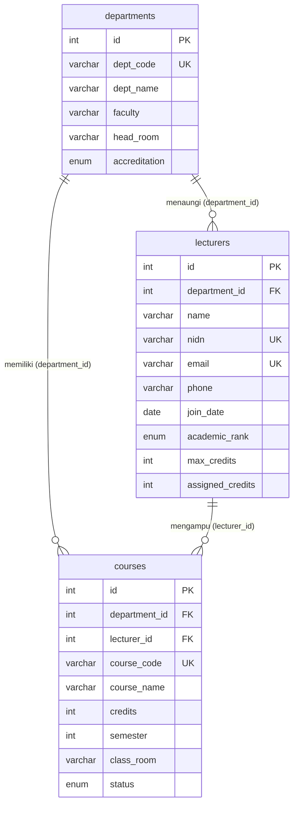

### Penjelasan Tabel dan Foreign Key

| Nama Tabel | Primary Key | Foreign Key & Aturan Relasi | Fungsi Tabel |
| :--- | :--- | :--- | :--- |
| `departments` | `id` | - | Tabel induk program studi/departemen tempat dosen bernaung dan mata kuliah diselenggarakan. |
| `lecturers` | `id` | `department_id` -> `departments(id)` (`ON DELETE RESTRICT ON UPDATE CASCADE`) | Menyimpan profil dosen (`name`, `nidn`, `email`, `phone`, `join_date`, `academic_rank`) serta kuota (`max_credits`) dan total SKS aktif (`assigned_credits`). |
| `courses` | `id` | `department_id` -> `departments(id)` (`ON DELETE RESTRICT ON UPDATE CASCADE`)<br>`lecturer_id` -> `lecturers(id)` (`ON DELETE RESTRICT ON UPDATE CASCADE`) | Menyimpan daftar mata kuliah, bobot SKS, semester, ruang kelas, status perkuliahan, dan relasi ke prodi serta dosen pengampu. |

---

## 5. Class Diagram & Prinsip OOP (SOLID)

### Class Diagram

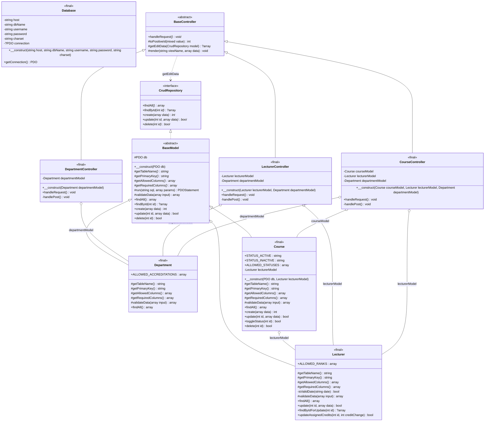

### Alasan Pemilihan Kelas dan Atribut

| Nama Kelas / Interface | Alasan Pemilihan Kelas & Atribut |
| :--- | :--- |
| `Database` | Memisahkan konfigurasi koneksi (`$host`, `$dbName`, `$username`, `$password`, `$charset`) dan instansiasi objek tunggal `$connection` (`PDO`) dari logika model maupun controller. |
| `CrudRepository` | Mendefinisikan kontrak antarmuka kecil yang berisi 5 operasi dasar CRUD (`findAll`, `findById`, `create`, `update`, `delete`) sehingga seluruh model memiliki antarmuka konsisten. |
| `BaseModel` | Menyimpan referensi `$db` (`PDO`) dan mengimplementasikan query CRUD generik agar tidak ada duplikasi kode di model anak. Seluruh eksekusi query dipusatkan di `#run()` dengan `prepare()` + `execute()` serta `#validateData()` berbasis whitelist kolom. |
| `Department` | Merepresentasikan tabel `departments` dengan konstanta `ALLOWED_ACCREDITATIONS`, normalisasi/validasi kode departemen, dan query `findAll()` untuk menghitung relasi jumlah dosen dan mata kuliah. |
| `Lecturer` | Merepresentasikan tabel `lecturers` dengan konstanta `ALLOWED_RANKS`, validasi NIDN, email, tanggal, dan `max_credits`, query `INNER JOIN` ke `departments`, serta `findByIdForUpdate()` dan `updateAssignedCredits()` untuk transaksi SKS yang aman. |
| `Course` | Merepresentasikan tabel `courses` dengan konstanta status (`STATUS_ACTIVE`, `STATUS_INACTIVE`, `ALLOWED_STATUSES`) dan agregasi ke `$lecturerModel` untuk menjaga konsistensi `assigned_credits` dosen dalam satu transaksi DB. |
| `BaseController` | Menyediakan kontrak `handleRequest()` dan utilitas bersama untuk controller (`toPositiveId`, `getEditData`, `render`) agar lapisan controller tetap ringkas tanpa duplikasi. |
| `DepartmentController` | Menangani alur request GET dan POST (PRG) khusus entitas `departments` dengan meng-inject `$departmentModel`. |
| `LecturerController` | Menangani alur request GET dan POST (PRG) khusus entitas `lecturers` dengan meng-inject `$lecturerModel` dan `$departmentModel` (untuk mengisi dropdown departemen). |
| `CourseController` | Menangani alur request GET dan POST (termasuk aksi `toggle_status`) untuk entitas `courses` dengan meng-inject `$courseModel`, `$lecturerModel`, dan `$departmentModel`. |

### Penerapan Prinsip SOLID

1. **Single Responsibility Principle (S)**:
   - `Database` hanya menangani pembukaan koneksi `PDO`.
   - `BaseModel` dan turunannya (`Department`, `Lecturer`, `Course`) hanya mengelola akses data, validasi aturan domain, dan transaksi SQL.
   - `BaseController` dan turunannya (`DepartmentController`, `LecturerController`, `CourseController`) hanya menangani alur request HTTP, penyiapan flash message/redirect (PRG), dan pemilihan view.
   - File di `views/` hanya merender HTML dan men-escape output dengan `e()` tanpa memanggil PDO atau query langsung.
2. **Open/Closed Principle (O)**:
   - Penambahan tabel/entitas baru cukup dilakukan dengan membuat subclass baru dari `BaseModel` dan `BaseController` tanpa mengubah logika CRUD generik di `BaseModel`.
3. **Liskov Substitution Principle (L)**:
   - Seluruh subclass model (`Department`, `Lecturer`, `Course`) menjaga kompatibilitas signature method dan return type dari `CrudRepository` dan `BaseModel` (misal dipanggil secara polimorfik di `BaseController::getEditData(CrudRepository $model)`).
4. **Interface Segregation Principle (I)**:
   - `CrudRepository` dibuat minimal (5 method inti CRUD) sehingga model tidak dipaksa mengimplementasikan method yang tidak relevan dengan tabelnya.
5. **Dependency Inversion Principle (D)**:
   - Seluruh dependensi (`PDO`, `Department`, `Lecturer`, `Course`) di-inject melalui constructor dari `index.php`; tidak ada class model atau controller yang melakukan `new Database()` atau membuat dependensi secara hardcoded di dalam method.

---

## 6. Alur Kode (Flow Aplikasi MVC)

Alur eksekusi mengikuti arsitektur MVC:
**Browser → `index.php` → `Controller` → `Model` → `PDO` → `Database` → `Model` → `Controller` → `View` → Browser**

### Sequence Diagram

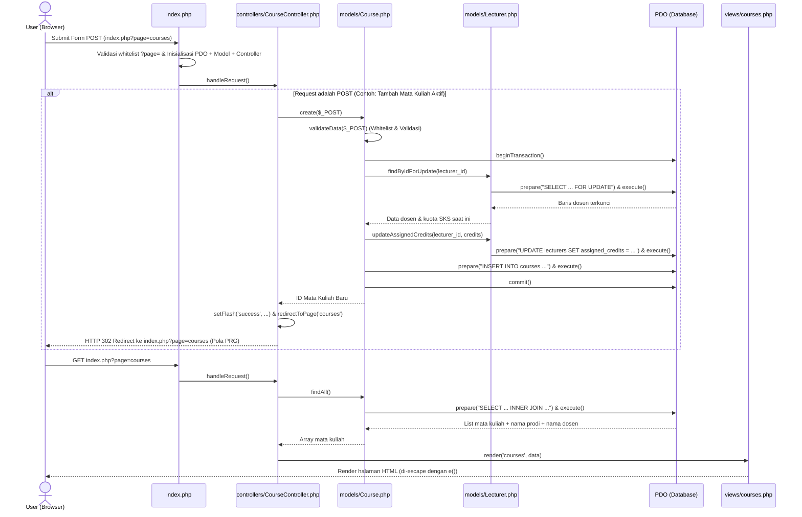

### Penjelasan Langkah demi Langkah & Aturan Logika Khusus

1. **Inisialisasi, Autoload, & Routing (`index.php` & `config/bootstrap.php`)**:
   - Seluruh request masuk melalui `index.php`.
   - `config/bootstrap.php` memulai session, memuat `database.php` dan `helpers.php`, serta mendaftarkan `spl_autoload_register` untuk memuat class dari `models/` dan `controllers/`.
   - Parameter `$_GET['page']` divalidasi dengan daftar whitelist `['lecturers', 'departments', 'courses']` (default `lecturers`) untuk mencegah Local File Inclusion (LFI), lalu `index.php` menginstansiasi controller sesuai halaman dan memanggil `handleRequest()`.
2. **Pola Post/Redirect/Get (PRG)**:
   - Setiap request `POST` (`create`, `update`, `toggle_status`, `delete`) diproses oleh controller di dalam blok `try-catch`.
   - Jika berhasil maupun gagal (`PDOException` diterjemahkan lewat `translateException()`), pesan status disimpan ke session flash message (`setFlash()`), kemudian browser di-redirect ke GET halaman terkait (`redirectToPage()`) agar tidak terjadi pengiriman ulang form saat refresh.
3. **Sinkronisasi Beban SKS Transaksional (`Course` & `Lecturer`)**:
   - Operasi `Course::create()`, `Course::update()`, `Course::toggleStatus()`, dan `Course::delete()` berjalan di dalam `PDO::beginTransaction()`.
   - Sebelum menambah beban SKS mata kuliah berstatus `Aktif`, baris dosen dikunci dengan `SELECT ... FOR UPDATE` (`Lecturer::findByIdForUpdate()`) agar bebas dari *race condition*.
   - Jika `assigned_credits + credits > max_credits`, transaksi dibatalkan (`rollBack()`) dan pengguna menerima pesan ramah mengenai sisa kuota SKS dosen tersebut.
   - Saat mata kuliah diubah statusnya menjadi `Nonaktif` atau dihapus saat masih `Aktif`, beban SKS dosen otomatis dikurangi kembali.

---

## 7. Cara Menjalankan

1. **Kebutuhan Sistem**:
   - PHP >= 8.1 dengan ekstensi `pdo_mysql` aktif.
   - MySQL / MariaDB (misal melalui XAMPP atau Laragon).
   - Web Browser (Chrome / Edge / Firefox).
2. **Salin Folder Project**:
   - Letakkan folder `TP8DPBO2526C1` ke direktori web server lokal (misal `C:\xampp\htdocs\TP8DPBO2526C1` atau `C:\laragon\www\TP8DPBO2526C1`).
3. **Import Database**:
   - Jalankan service **Apache** dan **MySQL** di XAMPP / Laragon.
   - Buka **phpMyAdmin** (`http://localhost/phpmyadmin`) lalu import file `database/tp_mvc25.sql`.
   - File SQL tersebut otomatis membuat database `tp_mvc25`, 3 tabel berelasi (`departments`, `lecturers`, `courses`), serta data awal dosen Ilmu Komputer UPI yang konsisten.
4. **Konfigurasi Koneksi (Opsional)**:
   - Default koneksi di `config/database.php` adalah host `127.0.0.1`, database `tp_mvc25`, username `root`, dan password `""`. Sesuaikan bila konfigurasi MySQL lokal kamu berbeda.
5. **Akses Aplikasi di Browser**:
   - Buka `http://localhost/TP8DPBO2526C1/` (atau jalankan `php -S localhost:8000` di dalam folder `TP8DPBO2526C1`, lalu akses `http://localhost:8000`).

### Skenario Pengujian (Test Case)

#### 1. Halaman Departemen (`index.php?page=departments`)

| Kode | Skenario Uji | Langkah & Data Input | Hasil yang Diharapkan (Expected Result) |
| :--- | :--- | :--- | :--- |
| **TC-DPT-01** | **Create** (Tambah Departemen Baru) | Isi form:<br>- Kode Departemen: `TK-S1`<br>- Nama Departemen/Prodi: `Teknik Komputer`<br>- Fakultas: `FPMIPA UPI`<br>- Ruang Kantor Prodi: `Gedung JICA Lt. 2 R.205`<br>- Akreditasi: `Baik Sekali`<br>Klik **Tambah Departemen**. | Muncul alert sukses *"Data departemen berhasil ditambahkan."* Data `TK-S1` tampil di tabel dengan `0 Dosen` & `0 Mata Kuliah`. |
| **TC-DPT-02** | **Validasi Duplikat Kode** | Isi form dengan Kode Departemen yang sudah ada:<br>- Kode Departemen: `TK-S1` *(duplikat)*<br>- Nama: `Teknologi Informasi`<br>- Fakultas: `FPMIPA UPI`<br>- Ruang Kantor: `Gedung A Lt. 1`<br>- Akreditasi: `Baik`<br>Klik **Tambah Departemen**. | Ditolak oleh constraint `UNIQUE` dengan pesan error ramah: *"Gagal menyimpan: Data dengan kode, NIDN, atau email tersebut sudah terdaftar (tidak boleh sama)."* |
| **TC-DPT-03** | **Update** (Edit Departemen) | Klik **Edit** pada `TK-S1`, ubah Ruang Kantor menjadi `Gedung FPMIPA-C Lt. 2` dan Akreditasi menjadi `Unggul`, lalu klik **Simpan Perubahan**. | Muncul alert sukses *"Data departemen berhasil diperbarui."* Baris `TK-S1` menampilkan ruang baru dan badge akreditasi `Unggul`. |
| **TC-DPT-04** | **Delete (Proteksi Foreign Key)** | Klik **Hapus** pada departemen `IF-S1` (Ilmu Komputer, yang masih memiliki dosen dan mata kuliah), lalu konfirmasi OK. | Penghapusan ditolak oleh `ON DELETE RESTRICT` dengan pesan ramah: *"Gagal menghapus: Data ini tidak bisa dihapus karena masih dipakai oleh data di tabel lain."* |
| **TC-DPT-05** | **Delete (Berhasil)** | Klik **Hapus** pada departemen `MTK-S1` (Matematika, yang belum memiliki dosen/MK), lalu konfirmasi OK. | Muncul alert sukses *"Data departemen berhasil dihapus."* Baris `MTK-S1` terhapus dari tabel. |

#### 2. Halaman Dosen (`index.php?page=lecturers`)

| Kode | Skenario Uji | Langkah & Data Input | Hasil yang Diharapkan (Expected Result) |
| :--- | :--- | :--- | :--- |
| **TC-LCT-01** | **Create** (Tambah Dosen Baru) | Isi form:<br>- Departemen/Prodi: `[IF-S1] Ilmu Komputer`<br>- Nama Lengkap & Gelar: `Dr. Eddy Prasetyo Nugroho, M.T.`<br>- NIDN: `0012047609`<br>- No. Telepon: `081220114009`<br>- Email: `eddy@upi.edu`<br>- Tanggal Bergabung: `2006-05-01`<br>- Kuota Maks. SKS: `12`<br>- Jabatan Akademik: `Lektor Kepala`<br>Klik **Tambah Dosen**. | Muncul alert sukses *"Data dosen berhasil ditambahkan."* Dosen baru tampil dengan badge `IF-S1` Ilmu Komputer hasil `INNER JOIN` dan beban `0/12 SKS`. |
| **TC-LCT-02** | **Validasi Kuota Maks. SKS** | Klik **Edit** pada `Rosa Ariani Sukamto, S.T., M.T.` (beban aktif `7/12 SKS`), ubah Kuota Maks. SKS menjadi `4`, klik **Simpan Perubahan**. | Sistem menolak dengan pesan: *"Kuota maksimal SKS (4) tidak boleh lebih kecil dari beban SKS aktif saat ini (7 SKS)."* |
| **TC-LCT-03** | **Update** (Edit Dosen Valid) | Klik **Edit** pada `Dr. Eddy Prasetyo Nugroho, M.T.`, ubah Kuota Maks. SKS menjadi `14`, klik **Simpan Perubahan**. | Muncul alert sukses *"Data dosen berhasil diperbarui."* Beban SKS di tabel berubah menjadi `0/14 SKS`. |
| **TC-LCT-04** | **Delete (Proteksi Foreign Key)** | Klik **Hapus** pada `Rosa Ariani Sukamto, S.T., M.T.` (masih mengampu 2 MK), lalu konfirmasi OK. | Penghapusan ditolak dengan pesan: *"Gagal menghapus: Data ini tidak bisa dihapus karena masih dipakai oleh data di tabel lain."* |
| **TC-LCT-05** | **Delete (Berhasil)** | Klik **Hapus** pada `Hafiz Rifai, M.Kom.` (belum mengampu mata kuliah, `0 MK`), lalu konfirmasi OK. | Muncul alert sukses *"Data dosen berhasil dihapus."* Baris `Hafiz Rifai, M.Kom.` terhapus dari tabel. |

#### 3. Halaman Mata Kuliah (`index.php?page=courses`)

| Kode | Skenario Uji | Langkah & Data Input | Hasil yang Diharapkan (Expected Result) |
| :--- | :--- | :--- | :--- |
| **TC-CRS-01** | **Validasi Kelebihan Kuota SKS** | Isi form:<br>- Kode MK: `IK399` \| SKS: `6` \| Semester: `5`<br>- Nama Mata Kuliah: `Proyek Perangkat Lunak`<br>- Departemen: `[IF-S1] Ilmu Komputer`<br>- Dosen Pengampu: `Rosa Ariani Sukamto, S.T., M.T. (7/12 SKS)`<br>- Ruang Kelas: `Lab Pemrograman Kemakom`<br>- Status: `Aktif`<br>Klik **Tambah Mata Kuliah**. | Transaksi dibatalkan (`rollBack`) dan muncul pesan error: *"Beban SKS dosen "Rosa Ariani Sukamto, S.T., M.T." melebihi kuota (terpakai: 7/12 SKS, tambahan: 6 SKS)."* |
| **TC-CRS-02** | **Create MK Aktif & Sinkronisasi SKS** | Ubah bobot SKS pada data di atas menjadi `3`, lalu klik **Tambah Mata Kuliah**. Kemudian cek halaman **Dosen**. | Muncul alert sukses *"Mata kuliah berhasil ditambahkan dan beban SKS dosen telah diperbarui."* Beban SKS `Rosa Ariani Sukamto` naik dari `7/12` menjadi `10/12 SKS` (`3 MK`). |
| **TC-CRS-03** | **Toggle Status (`Aktifkan` / `Nonaktifkan`)** | Klik tombol **Aktifkan** pada mata kuliah `RL302 - Sistem Operasi Terdistribusi` (milik `Abdillah Ridho Alriza, M.T.`, awal `Nonaktif`). | Muncul alert sukses *"Status mata kuliah dan beban SKS dosen berhasil disinkronkan."*, status `RL302` menjadi `Aktif`, dan di halaman **Dosen** beban SKS `Abdillah Ridho Alriza` naik dari `0/10` menjadi `3/10 SKS`. |
| **TC-CRS-04** | **Update Mata Kuliah & Penyesuaian SKS** | Klik **Edit** pada `IK399`, ubah SKS menjadi `2` dan Ruang Kelas menjadi `Ruang S-301 JICA`, lalu klik **Simpan Perubahan**. | Muncul alert sukses *"Data mata kuliah dan beban SKS dosen berhasil diperbarui."* Beban SKS `Rosa Ariani Sukamto` otomatis menyesuaikan dari `10/12` menjadi `9/12 SKS`. |
| **TC-CRS-05** | **Delete MK Aktif (Pemulihan SKS)** | Klik **Hapus** pada `IK399` (status `Aktif`, `2 SKS`), lalu konfirmasi OK. | Muncul alert sukses *"Data mata kuliah berhasil dihapus dan kuota SKS telah disesuaikan."* Beban SKS `Rosa Ariani Sukamto` otomatis kembali menjadi `7/12 SKS`. |

---

## 8. Dokumentasi

Aplikasi **SIM Akademik MVC** telah dijalankan secara lokal pada Apache + MySQL (XAMPP) setelah meng-import `database/tp_mvc25.sql`. Seluruh skenario CRUD, validasi kuota SKS transaksional, dan proteksi *foreign key* terdokumentasi di folder [`docs/`](docs/).

### Checklist Pengujian

- [x] Menampilkan struktur database `tp_mvc25` di phpMyAdmin (3 tabel: `courses`, `departments`, `lecturers`).
- [x] **Halaman Departemen (`?page=departments`)**: Tambah departemen (`TK-S1`), edit akreditasi/ruang, hapus departemen tanpa relasi (`MTK-S1`), dan proteksi gagal hapus departemen berelasi (`IF-S1`).
- [x] **Halaman Dosen (`?page=lecturers`)**: Tambah dosen baru (`Dr. Eddy Prasetyo Nugroho, M.T.`), validasi kuota `max_credits < assigned_credits`, edit kuota SKS, hapus dosen tanpa MK (`Hafiz Rifai, M.Kom.`), dan proteksi gagal hapus dosen yang mengampu MK.
- [x] **Halaman Mata Kuliah (`?page=courses`)**:
  - [x] Validasi penolakan ketika SKS melebihi kuota dosen (`7/12 + 6 > 12 SKS`).
  - [x] Tambah mata kuliah `Aktif` (`IK399`, `3 SKS`) dan sinkronisasi SKS dosen menjadi `10/12 SKS`.
  - [x] Tombol **Aktifkan** pada `RL302`, **Edit** `IK399` (`2 SKS`), dan **Hapus** `IK399` beserta pemulihan kuota SKS dosen.
- [ ] *(Opsional)* Tambahkan video *screen record* ke folder `docs/` atau tautan YouTube bila ingin melengkapi dokumentasi dengan rekaman video.

### Hasil Screenshot Pengujian (`docs/`)

#### 1. Database (`tp_mvc25`)

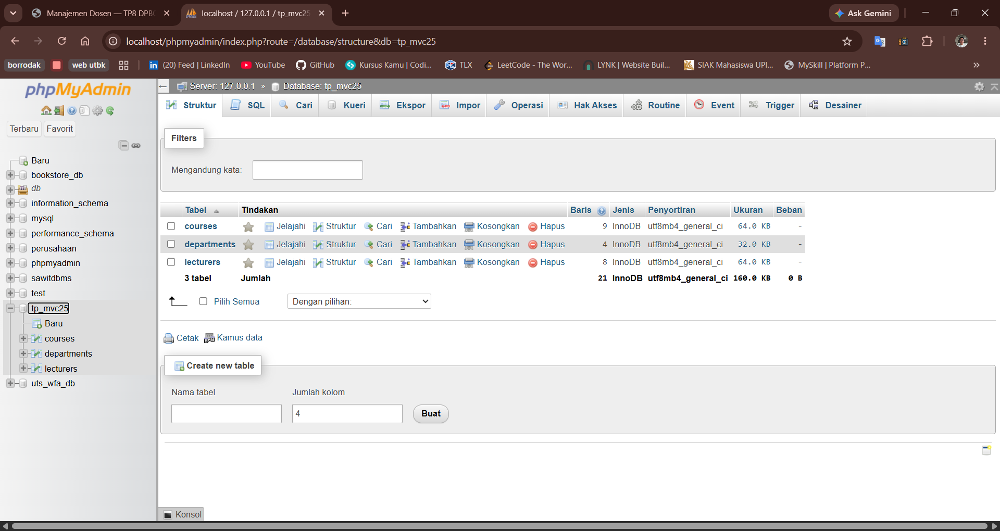

#### 2. Halaman Departemen (`?page=departments`)

| Tambah Departemen (`TC-DPT-01`) | Form Edit Departemen (`TC-DPT-03`) |
| :---: | :---: |
| 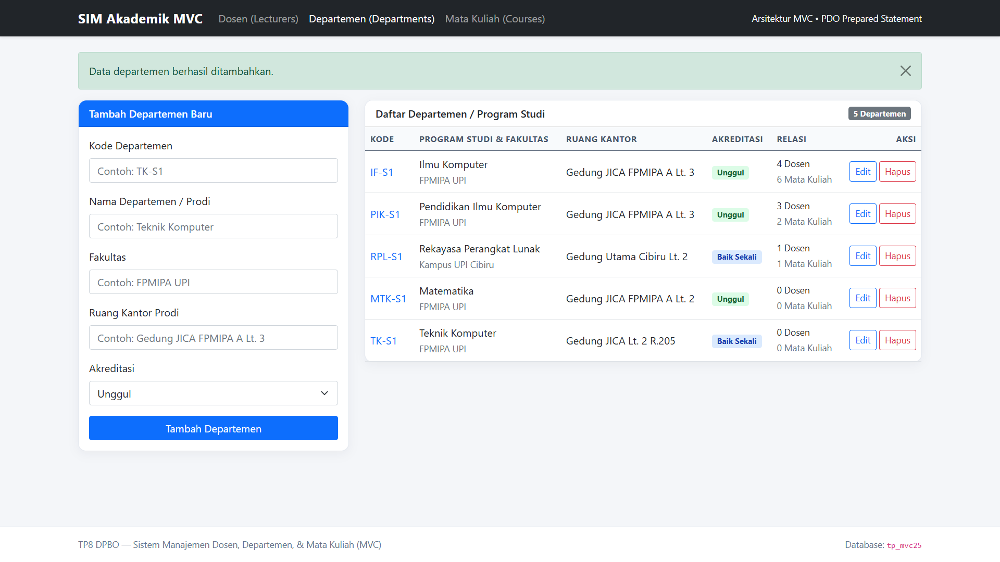 | 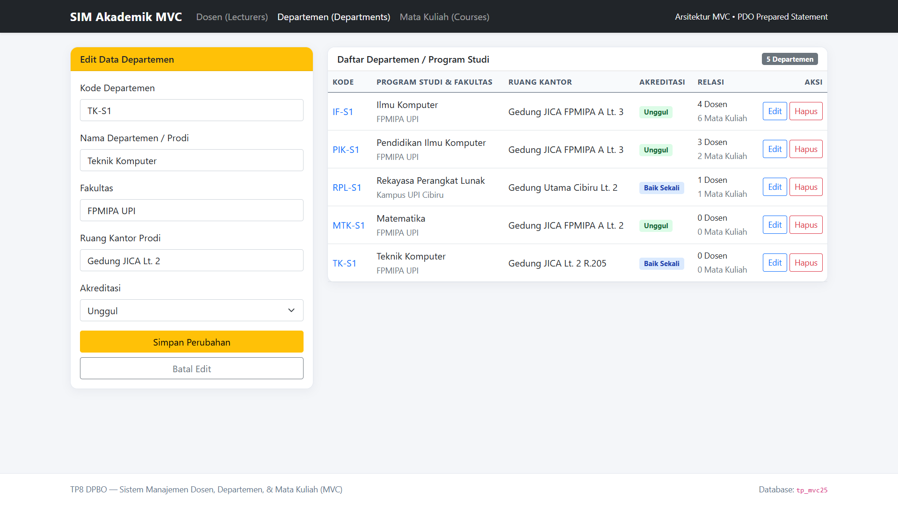 |

| Hasil Update Departemen (`TC-DPT-03`) | Hapus Departemen Kosong (`TC-DPT-05`) | Proteksi FK Gagal Hapus (`TC-DPT-04`) |
| :---: | :---: | :---: |
|  |  | 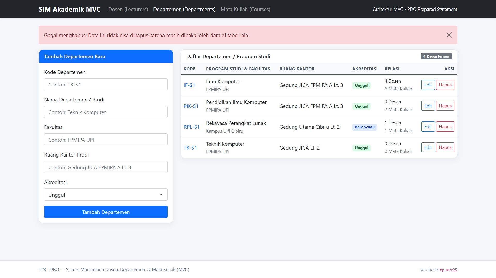 |

#### 3. Halaman Dosen (`?page=lecturers`)

| Tambah Dosen Baru (`TC-LCT-01`) | Validasi Kuota SKS < Aktif (`TC-LCT-02`) | Form Edit Dosen (`TC-LCT-03`) |
| :---: | :---: | :---: |
| 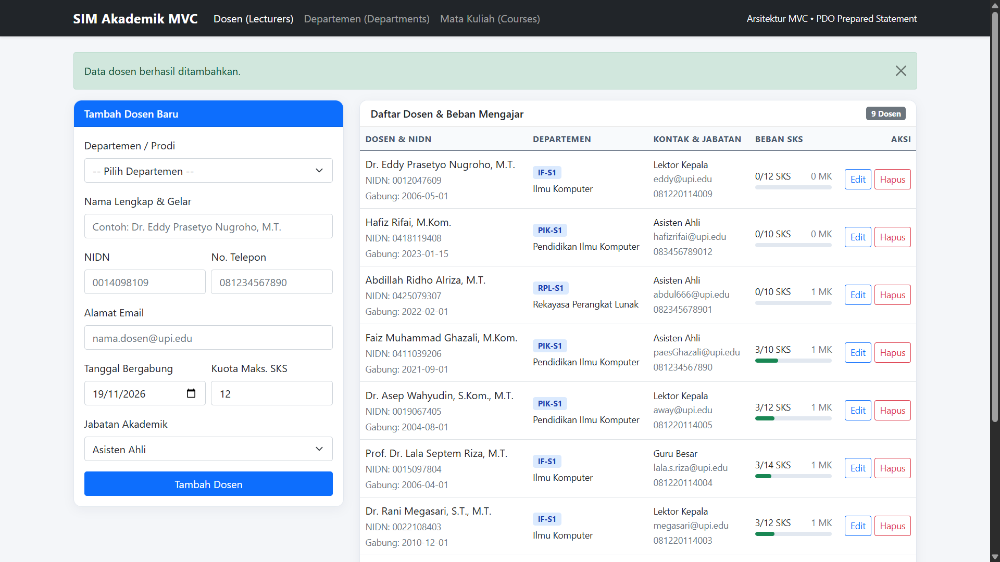 | 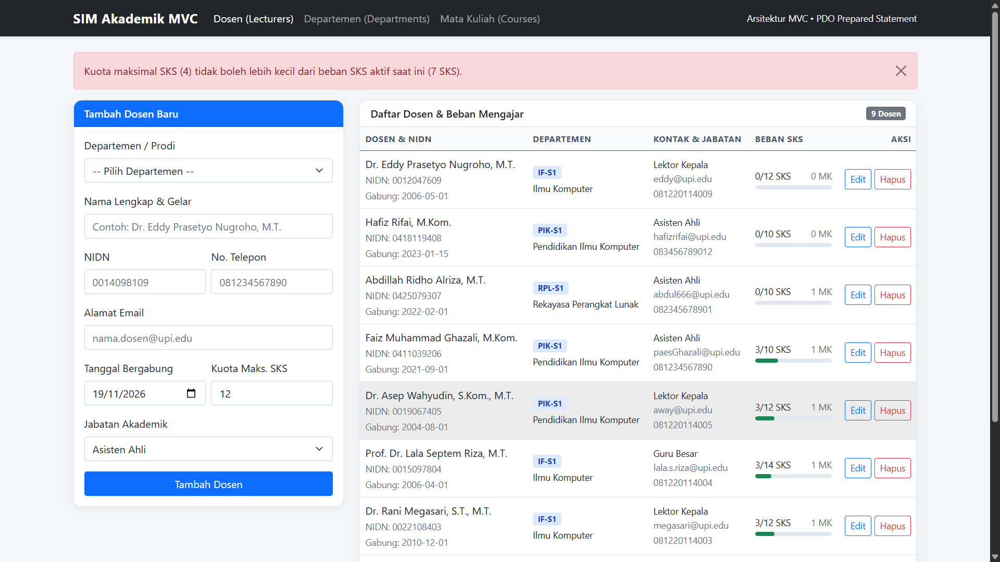 | 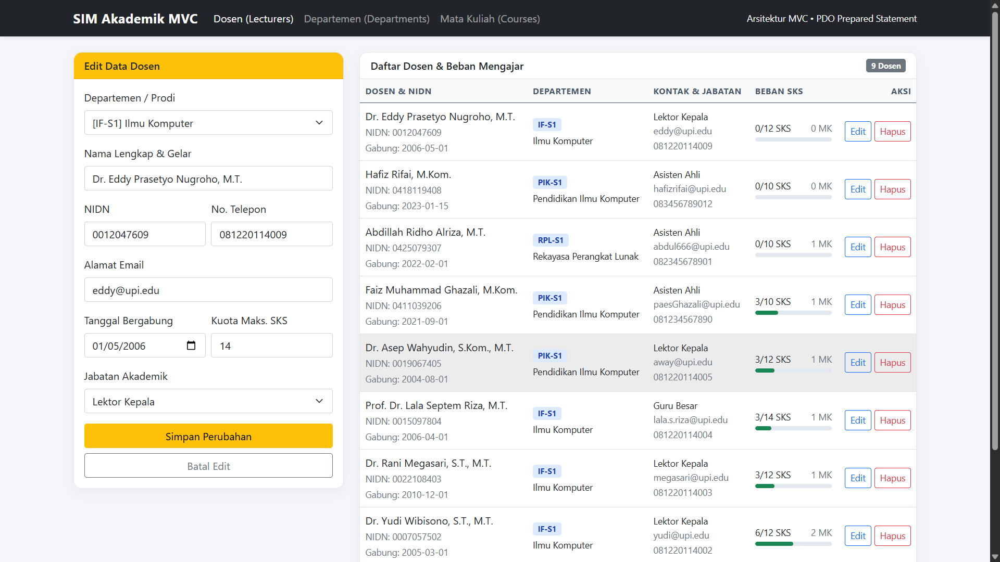 |

| Hasil Update Kuota SKS (`TC-LCT-03`) | Hapus Dosen Tanpa MK (`TC-LCT-05`) | Proteksi FK Gagal Hapus (`TC-LCT-04`) |
| :---: | :---: | :---: |
| 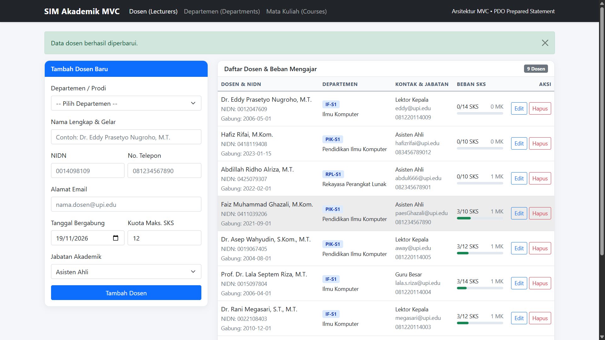 | 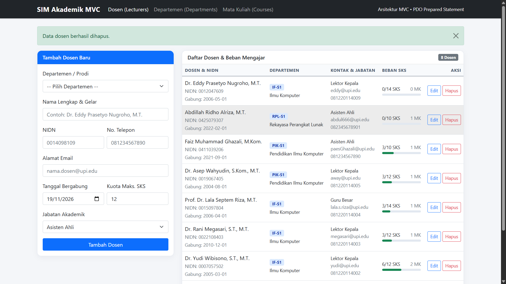 | 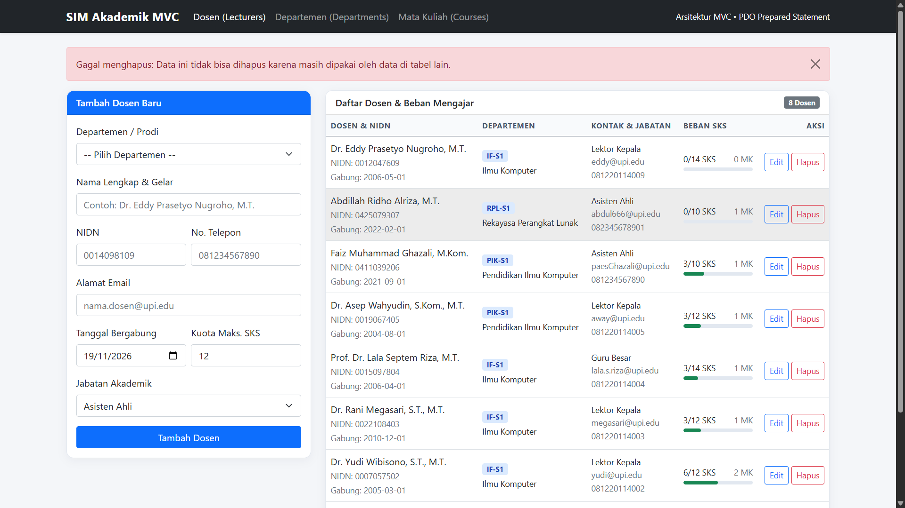 |

#### 4. Halaman Mata Kuliah (`?page=courses`)

| Validasi Kelebihan Kuota SKS (`TC-CRS-01`) | Tambah MK Aktif & Sinkron SKS (`TC-CRS-02`) | Toggle Status Aktifkan (`TC-CRS-03`) |
| :---: | :---: | :---: |
| 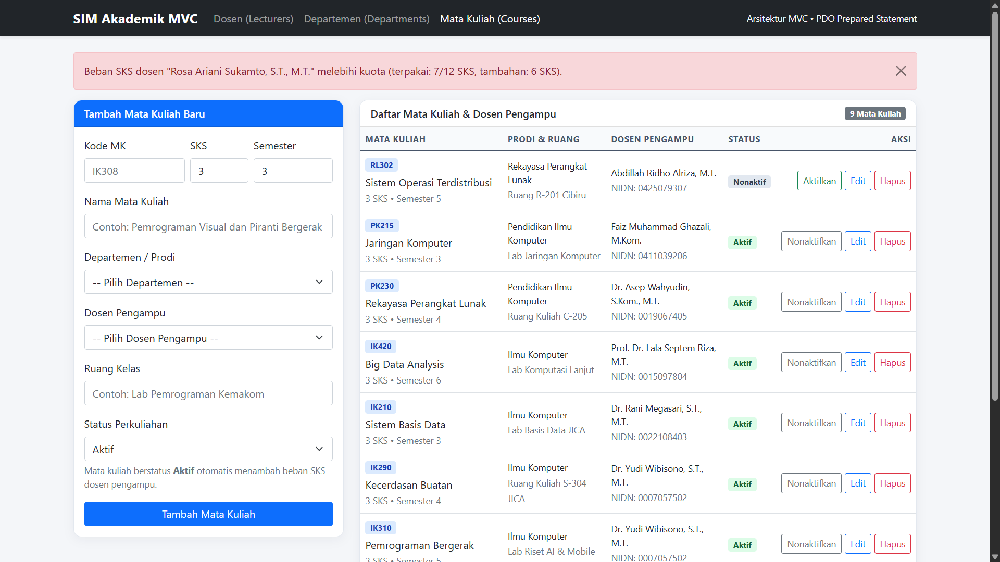 |  | 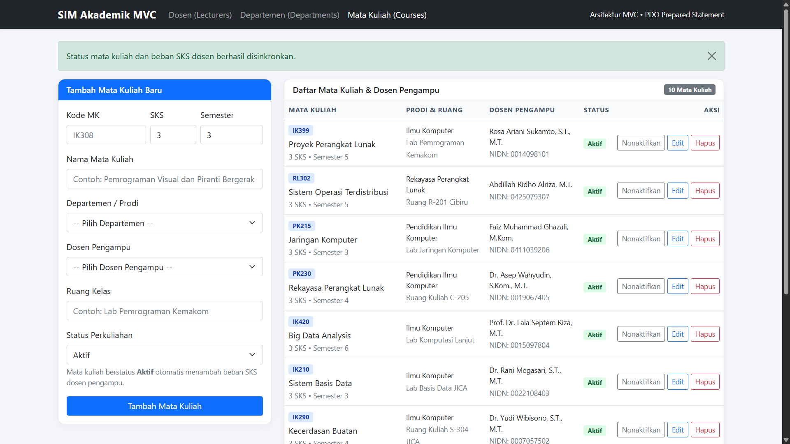 |

| Form Edit MK (`10/12 SKS` Terlihat) | Hasil Update MK (`TC-CRS-04`) | Hapus MK & Pemulihan SKS (`TC-CRS-05`) |
| :---: | :---: | :---: |
| 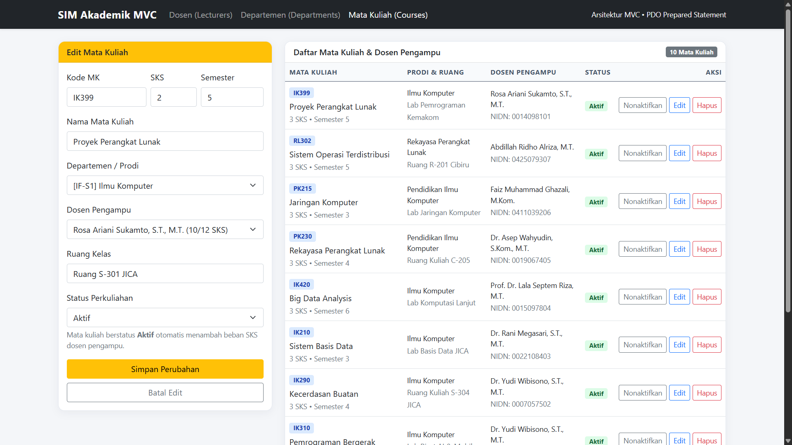 |  | 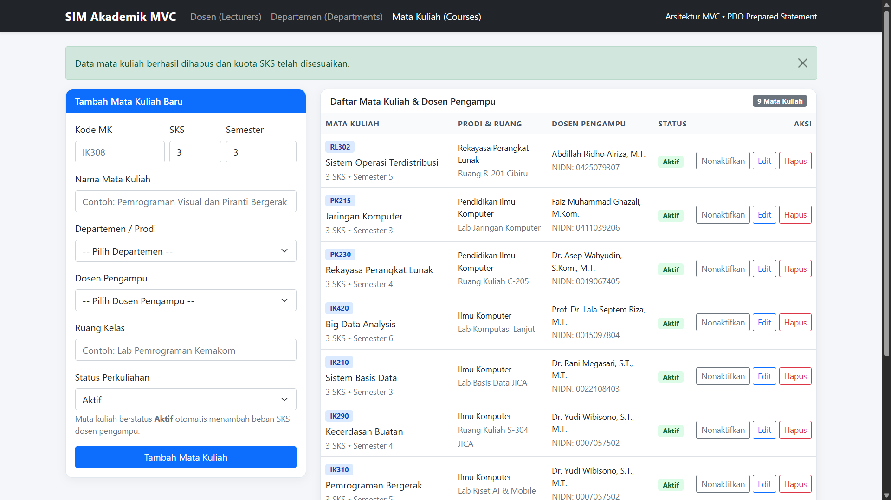 |

